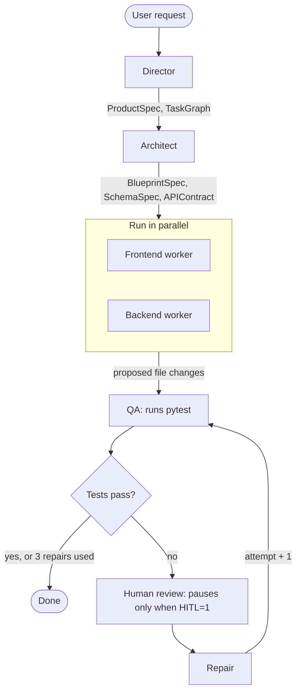

# Vibecoder LangChain Agent

Vibecoder is a teaching example for a LangChain + LangGraph multi-agent coding workflow. It takes a product request, creates structured planning output, builds technical contracts, runs frontend/backend worker agents, checks tests, and shows where repair and human review fit.

## Setup

From the repo root:

```bash
cd "example langchain agents/vibecoder"
python3 -m venv .venv
source .venv/bin/activate
python -m pip install --upgrade pip
pip install -r requirements.txt
```

Create your local environment file:

```bash
cp .env.example .env
```

Edit `.env` and add your OpenAI API key:

```bash
OPENAI_API_KEY=your_openai_api_key_here
MODEL_NAME=gpt-4.1-mini
HITL=0
```

`MODEL_NAME` is optional. `HITL=1` pauses the workflow before repair when QA creates repair tickets.

## Run

The runnable workshop file is in `run_vibecoder/`:

```bash
python run_vibecoder/vibecoder_langchain.py
```

The script makes real OpenAI calls. Keep the virtual environment active and make sure `.env` exists in the `vibecoder/` folder before running it.

## Use

The runner uses the sample request inside `run_vibecoder/vibecoder_langchain.py`:

```python
USER_REQUEST = """
Build a simple task management application.
...
"""
```

To try a different app idea, edit `USER_REQUEST` and run the file again.

During a run, the script prints each workshop section:

1. What are we building?
2. LLM
3. Agent
4. Tools
5. Structured output
6. State
7. Full LangGraph workflow

The final output prints the state keys, QA status, and repair attempt count. Generated demo files are written under `workspace/`.

## Workflow



Director, Architect, the two workers, and Repair call the LLM. QA and Human review are plain Python. A run where tests pass first time makes 7 LLM calls; each failed QA round adds one more, up to 3.

## Test

Run these from the `vibecoder/` folder:

```bash
pytest                      # fast unit tests in tests/
pytest e2e -m "not live"    # full workflow with a fake LLM, no API calls
pytest e2e -m live          # full workflow with real OpenAI calls
```

The live tests use `OPENAI_API_KEY` from `.env` and are skipped when it is missing. A full live run takes about two minutes and costs a few cents on `gpt-4.1-mini`.

A bare `pytest` only collects `tests/`. This matters because the QA step runs `pytest` itself, so the end-to-end tests must stay out of that run.

## Project Map

`run_vibecoder/`

Contains `vibecoder_langchain.py`, the main file to run. It is a commented walkthrough that imports the real project modules and wires the workshop flow together.

`src/agents/`

Agent functions. `base.py` creates the shared LLM, loads `.env`, and loads prompts. `director.py` turns a request into product and task plans. `architect.py` creates the technical blueprint, schema, and API contract. `frontend.py` and `backend.py` generate proposed implementation changes. `qa_repair.py` turns test failures into repair tickets and asks the LLM for fixes.

`src/graph/`

LangGraph workflow pieces. `state.py` defines the shared workflow state. `nodes.py` adapts agent functions into graph nodes. `graph.py` shows the smaller reference graph (Director to Architect only); run it with `python -m vibecoder.src.graph.graph` from the `example langchain agents/` folder. `routing.py` decides whether QA should end or route to repair.

`src/prompts/`

Markdown system prompts for each agent. Edit these when you want to change how an agent reasons or formats output.

`src/schemas/`

Pydantic models used for structured LLM output and typed state, including product specs, tasks, architecture, API contracts, database schemas, test reports, and repair tickets. Name/type pairs are lists of `FieldSpec` rather than free-form dicts, because OpenAI structured output rejects schemas with arbitrary keys.

`src/tools/`

Small local tools used by the workflow. `filesystem.py` reads and writes files inside `workspace/`. `testing.py` runs pytest with the current Python interpreter and returns a structured test report. `artifacts.py` saves and loads JSON artifacts. `git.py` and `search.py` are placeholders for source-control and search-style tool work.

`src/resources/`

Reference guidance for generated applications: architecture rules, coding standards, API/database conventions, design system notes, security guidance, and testing guidance.

`examples/`

Static example input and example run notes for readers who want to understand the intended workflow before running it.

`tests/`

Pytest unit checks for schemas and tools.

`e2e/`

End-to-end tests of the whole workflow. `test_workflow_offline.py` swaps the LLM for a fake to test the graph wiring and repair loop. `test_workflow_live.py` makes real OpenAI calls. `conftest.py` holds the shared fixtures.

`workspace/`

Sandbox folder for files generated or read by the local tools. The runner may create `workspace/workshop_note.txt`.

`pyproject.toml`

Project metadata and pytest configuration, including the `live` test marker.

`.env.example`

Template for local environment variables. Copy it to `.env`.

`requirements.txt`

Python packages needed to run `run_vibecoder/vibecoder_langchain.py` and the tests.

`.venv/`

Your local virtual environment from the setup step. Not committed.
